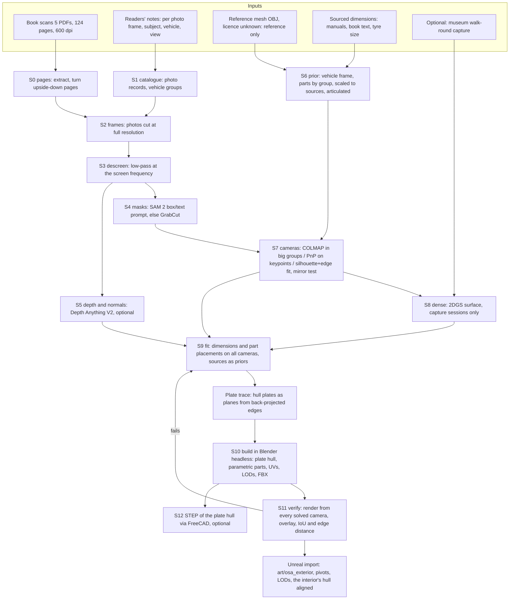

# The Osa's exterior from photographs: the reconstruction pipeline (plan)

Written 6 November 2026. The project owner asked for an automated pipeline that turns the high-resolution scans of
*SA-8 Gecko in Detail* (`wwp_gecko`; research: `docs/research/OSA_BOOK_WWP_2026-11.md`) and a low-detail reference mesh
into an accurate, game-ready model of the 9A33BM2 launcher vehicle, without an artist modelling by hand. The brief
asked for Structure-from-Motion, specular-aware neural surfaces, semantic part decomposition and mesh-to-NURBS. This
plan keeps its four phases but changes what runs in them, because a printed book is not a capture session. The
orchestrator is `tools/recon/osa_recon.py` (config `tools/recon/osa_9a33bm2.json`, tests `tools/tests/test_recon.py`).
It extends `docs/MODELLING_FROM_PHOTOS.md` ("Vehicles"): same rule, now for many photographs at once.

**Order:** the interior comes first (`docs/OSA_MODEL_ROADMAP.md`); this pipeline is the exterior track (X0-X5 there).

**The rule stays:** every dimension from a cited source or a measured fit, and the model is proven by rendering it from
each photo's solved camera and laying its outline on the photograph.

## 1. What the inputs really are, and what that changes

| The brief assumed | What the inputs are | So the pipeline |
|---|---|---|
| Several hundred multi-angle photos of one vehicle | 450 photos and drawings of **at least five physical vehicles** (Czech Army vehicles outdoors 2003-2006, an ex-NVA 9A33BM3-1 indoors, a hangar vehicle, a Greek vehicle in Athens, Iraqi vehicles restored in the UK, a reload vehicle on a rail wagon), early and late production, years apart. Mostly close-ups; only about 19 show the whole vehicle (`docs/research/OSA_BOOK_WWP_2026-11.md`) | Groups photos by physical vehicle and session (the catalogue); shares only what all vehicles share (the BAZ-5937 hull, the antenna-launcher unit's geometry); keeps per-vehicle differences (grilles, tyres, fittings) as variants |
| Raw photos with EXIF | Printed reproductions: **cropped** (the principal point is anywhere), maybe **mirrored**, no EXIF, a **halftone screen** (~200 lines per inch, four screen angles: about 3 px at 600 dpi) | Descreens before anything looks at features (S3); frees the principal point and tests the mirror image in every camera solve (S7); holds the focal length with a prior and perspective cues, since a distant silhouette trades focal length against distance |
| Overlapping views for SfM / MVS / NeRF | Few photos overlap the same surface from different places at the same time; the same surface on different vehicles differs (mud, wear, fittings) | Cameras are solved **against a 3-D prior** (the reference mesh, then the fitted model): analysis by synthesis, not two-view geometry. COLMAP runs only inside a vehicle-session group that has enough overlapping views. Dense neural surfaces (2DGS) are for a **walk-round capture**, never for the book |
| Specular car paint and glass | Matte military paint (specularity minor); the real occluders are **camouflage nets and branches** (the cover photo), crowds, deep shade under the hull, museum flash glare; glass is the windscreens, lamps, periscopes and the TV sight's window | Masks drop nets and foliage (and the catalogue flags those photos); glass is masked and replaced by parametric panes |
| Millimetre accuracy | A printed photo carries at most a few thousand pixels of real detail across the vehicle; at 9 m that is ~5-6 mm per pixel at best, and few photos are that square-on | **Main dimensions to about 1 cm from the written sources** (held as priors), **part positions to 1-3 cm** from multi-photo fits, **small parts sized from their neighbours** (bolt circles, hinges) to ~5 mm. Millimetres need a dimensioned drawing or a tape measure on a museum vehicle (section 8) |
| Scale from the wheelbase or tyre markings | The book prints the tyre size (1200 x 500-508, on the mid axle's page) and the sources give the overall length and the axle stations | Scale comes from the sourced dimensions as fit priors; the hubs' projected spacing in side views checks it |
| NURBS / STEP for engineering | A game needs a clean mesh with LODs; the hull is **welded flat plates**, so its exact form is planes, not freeform surfaces | The hull is built as a plate model (planar polygons welded at their real intersections): exact edges, clean quads, and a trivial exact STEP if anyone wants one. No NURBS fitting of a noisy mesh |
| "Non-rigid lens distortion" | One radial term per photo is enough (cropped prints, mostly normal lenses). The real non-rigidity is **articulation**: turret azimuth, antenna and launcher elevation, the search antenna folded or raised, hatches, steering, tyre deflection | Every photo's fit carries its own articulation; the model is built articulated (pivots for Unreal's animation and the crew's hatches) |
| No artist intervention | The project's acceptance test is a person looking at the overlays | Automated stage by stage, with checkpoints where a person accepts or corrects: the catalogue, keypoints on the few photos the silhouette solve can't place, the overlay report |

**The reference mesh** (`osa-akm-sam-system.zip`: a 9A33BM3, 421 466 triangles, 172 named groups such as
`bone_turret`, `antenna_target_location`, `suspension_l_01_06`, `breakwater_mount`, textures named `..._us_camo_modern_green`)
looks extracted from a commercial game. **Its licence is unknown: it is a reference and a stand-in only**, kept in
`reference/` (git-ignored), never exported into `art/` or Unreal, and every part of it is replaced by a part built from
the sources. Loaded in the vehicle frame (`axes ["-x", "z", "y"]`: bow at +y, its left lamps at −x, breakwater at y =
+4.43 m) it measures 9.37 x 3.08 x 5.49 m with the search antenna raised.

## 2. Architecture



The same as a data flow, with the files each stage writes under `out/recon/<name>/`:

```
E:/00x.pdf ─S0─> book/view/NNN.jpg, book/index.json  (full pages stay in the PDFs: ~6 GB as PNG)
notes/*.md ─S1─> catalogue.json (photo, page, bbox, subject, vehicle, az, height, coverage, solve, issues), groups.json
           ─S2─> photos/raw/<photo>.jpg            (full resolution, inset 0.4 % inside the printed frame; JPEG 95)
           ─S3─> photos/clean/<photo>.png          (descreened, ~300 dpi equivalent)
           ─S4─> masks/<photo>.png                 (whole-vehicle photos only)
           ─S5─> depth/<photo>_depth.png, _normal.png (optional)
OBJ+dims   ─S6─> prior.npz                          (surface samples with part labels, pivots)
           ─S7─> cameras.json                       (f, cx, cy, k1, R, t, method, iou, articulation, mirrored)
           ─S8─> dense/<group>/                     (optional)
           ─S9─> fit.json                           (scales, part offsets, residual per photo)
trace      ─S10> build/SM_Osa_9A33BM2.fbx, .blend, hull_faces.json, report.json
           ─S11> verify/<photo>.jpg, reports/verify.json
           ─S12> cad/hull.step                      (optional)
manifest.json: per stage status, attempts, seconds, inputs hash, outputs hash, metrics, note
```

## 3. Phase 1: ingestion, pose and metric calibration (S0-S7)

**S0 pages.** The scans are one embedded JPEG per page (5716 x 5314 px, ~600 dpi; no text layer). The book's left-hand
pages and the inside covers came out of the scanner upside down, all but the back cover: the config's rule
(`"turn": {"rule": "even", "except": [124]}`) turns them;
for another book, Tesseract's orientation detection (`--psm 0`; `osd.traineddata` is installed) can replace the rule.
Global page N is book page N − 2.

**S1 catalogue.** Eight readers went through every page (2026-11-06) and wrote, per photo, its frame on the page, its
subject and variant, which physical vehicle and session, the camera's azimuth round the vehicle (0 = ahead of the bow,
90 = right side, clockwise) and height, what it covers, whether it can carry a whole-vehicle camera solve, and its
problems. `book.parse_catalogue` reads them into `catalogue.json`; `groups_by_vehicle` groups them. This is the human
checkpoint that makes the rest automatic: a wrong azimuth or vehicle shows up later as a failed solve, not a silent
error.

**S2 frames.** Each photo cut from its page at full resolution, a hair inside the printed frame. The automatic frame
finder (`book.find_frames`, recursive XY-cut on the page's hue, drop shadows included) finds the simple layouts but
merges mosaic pages, where the shadows fill the gutters; the catalogue's boxes win, and the finder's recall against
them is reported. For a bigger corpus, a layout model (a document-layout detector's "figure" class) or SAM 2's
automatic masks on the page would replace it.

**S3 descreen.** The halftone screen is measured per photo (`book.screen_period`: the spectrum's strongest peak and the
peaks at its radius; the book gives 3.0 px at 45, 75, 105 and 135 degrees) and removed by a Gaussian low-pass just
below it, then resampled to two pixels per screen period. Nothing finer than the screen was ever printed, so this loses
no information; it takes 98.6 % of the screen's spectral energy out of a sample patch (`test_descreen_...`). Without
it, SIFT and edge detectors lock onto the dot grid.

**S4 masks.** SAM 2 (`ext_sam2_masks.py`, in a separate ML venv) with a box prompt from the frame, or Grounding DINO's
"vehicle" box when installed; GrabCut when SAM 2 isn't there. Only photos marked as solve candidates get masks.
Camouflage nets, branches and people are the failure modes; the catalogue's `issues` column marks those photos and the
fit weights them down.

**S5 depth and normals (optional).** Depth Anything V2 (Large fits the RTX 3060 Ti's 8 GB at 1024 px) gives relative
depth and normals per photo. Used as priors only, never as distances: a plate is one normal, so a plate polygon must not
straddle a normal change; thin parts (the antenna frames, the container ribs) are kept out of the hull's silhouette.

**S6 prior.** The reference mesh in the vehicle frame (x right, y forward, z up, metres, on the ground), cut into parts
by its group names (`wheel`, `turret`, `antenna`, `launcher`, `glass`, the rest `hull`), scaled per axis to the sourced
length and width, and sampled to 150 000 surface points with part labels for fast silhouettes. Pivots (the turret's
axis) from the sources. It is a starting shape, not the answer: the fit moves it, and the build replaces it.

**S7 cameras.** For every whole-vehicle photo, in order of preference:
1. **COLMAP** inside a vehicle-session group with at least 12 photos (SIMPLE_RADIAL, one camera per image, exhaustive
   matching); its cameras are registered to the prior by ICP of its sparse points (scale free) in S9.
2. **PnP on keypoints** when a person or a detector has marked at least six named points (hubs, ground contacts, the
   bow's corners, the stern's corners, the turret's ring): focal length searched on a grid, then focal, principal
   point and k1 refined with all points (`geometry.pnp`; recovers f to 3 % and the camera to 0.3 m on synthetic data).
3. **Silhouette and edges against the prior** from the catalogue's azimuth and height: Nelder-Mead over the pose, the
   focal length, the principal point shift and the photo's articulation (turret yaw), minimising (1 − IoU) plus the
   outline's distance to the photo's edges, from three starting distances, on the photo and on its mirror image (books
   flip photos; the better fit by 20 % wins and is flagged). 0.97 IoU on a synthetic view in 28 s on the CPU.
   **Known weakness:** from a distant silhouette the focal length trades against distance (the synthetic test found
   f 616 at 13 m for a truth of 761 at 16 m, same IoU). Fixes, in order: the hubs' row (six hubs at known stations give
   the perspective along the hull), the hull's parallel edges (vanishing points, as `photo_trace.py rectify` does), a
   prior on the focal length per photo class (a normal lens unless the catalogue says wide or tele), and joint fitting
   of several photos of one session that share a lens.

**Metric calibration.** The scale is never read from one photo. The sourced dimensions (overall length and width, the
axle stations, the track, the tyre's 1200 mm diameter) are priors with their sources' uncertainty in the S9 fit; the
hubs' spacing in side views and the tyre's ellipse in each photo are residuals. A disagreement beyond the sources'
sigma is reported, not averaged away (as `vehicle_fit.py` does for the PU-12M).

## 4. Phase 2: the surface (S8, S9)

**For the book: a model-based fit, not a reconstruction.** S9 adjusts the prior's dimensions and its parts' placements
on all solved cameras at once (silhouette IoU per photo, sourced dimensions as priors with their sigmas) and writes
`fit.json`. The next step from it is the **plate trace**: the hull as a set of planes, one per welded plate, each found
from the photos' edges back-projected through the solved cameras onto the plane the prior gives (the method
`vehicle_fit.py backproject` already uses for the PU-12M), the plates' intersections giving the hull's edges exactly.
`tools/traces/osa_9a33bm2_hull.json` holds it: plates as planar polygons with their photos, as the R-123M's trace holds
its front.

**ICP against the reference mesh.** The fitted model and the reference mesh are registered by point-to-plane ICP
(scale held by the sources, trimmed at 20 % for the parts the two don't share). Where they disagree by more than the
fit's uncertainty, the photos decide and the difference is listed: a game model is evidence of nothing.

**Dense surfaces for a capture session (S8, optional).** If someone photographs a preserved vehicle all round
(section 8: Lešany, Dresden, Koblenz), that set has what the book lacks, and the brief's dense path applies: COLMAP poses,
then **2D Gaussian Splatting** (surface-aligned, good for flat plates; depth-normal consistency on, Depth Anything V2
normals as an extra prior for thin panels), trained at half resolution on the 8 GB card. Its mesh (TSDF of the rendered
depths) is registered to the plate model by ICP and used to check it and to bake detail (welds, bolt heads, dents) into
normal maps, never as the game mesh itself. NeuS2 / instant-NSR need more memory and buy little on flat plates.
Specular handling there: masks for glass, the matte paint needing none; museum flash glare is masked by its saturation.

## 5. Phase 3: parts and feature lines

**Parts come mostly free.** The reference mesh is already in named parts (wheels, suspension, turret, antennas,
containers, lamps, hatches); the plan keeps that split and gives each part its own source. Where a part has no group
(or the game model merged it), 2-D segmentation in the photos is back-projected onto the model's surface and voted:
Grounding DINO + SAM 2 with prompts per part ("windscreen", "wheel", "hatch", "headlight", "antenna dish", "missile
container", "exhaust grille"), each label projected through the photo's camera onto the surface samples it covers, the
majority over photos kept. 3-D clustering (OpenShape, LERF) adds little on a vehicle whose parts are named already.

**Feature lines.** On the plate hull, the feature lines are the plates' intersections: exact by construction. Shut
lines of hatches, access panels, the stamped ribs and the welds are traced as curves on their plate: photo edges
back-projected onto the plate's plane, kept where two or more photos agree within 1 cm. On the reference mesh the
sharp edges are found by dihedral angle (above 20 degrees) and used only to seed the plate trace.

**Standard parts substituted** (built from their sources, not reconstructed):

| Part | Built from |
|---|---|
| Wheels | The tyre 1200 x 500-508 (book p. 036): 1200 mm outer diameter, 500 mm section, 508 mm (20 in) rim; the rim's double flange; the hub cover's bolt circles (16 outer, the CTIS swivel and its line) per the book's hub photos; the standard and the late herringbone treads as two variants |
| Missile containers | Their sourced length and section, ribs counted on the book's photos |
| Search antenna, tracking dish, missile-tracker and command antennas | Sizes from the sources; the dish as a paraboloid of revolution; frames as tubes |
| Lamps, periscopes, the TV sight's window | Primitives with glass material |
| Grilles, meshes | Flat panels with an opacity mask from the photos (early and late patterns, book p. 033) |

## 6. Phase 4: the game model (S10) and optional CAD (S12)

`blender_build.py` runs headless (`blender --background --factory-startup --python ... -- --config ... --run ...`,
tested with Blender 5.2): the plate hull from the trace (welded, normals out), the parametric tyres and rims on the axle
stations, the reference's other parts as stand-ins in their own collection (hidden from render, never exported), cube
UVs per plate at one texel density, LOD1-2 by decimation, FBX in the vehicle frame and a report of every stand-in left.
Quad topology comes from construction (plates and primitives are quads already), so no quad remesher is needed on
the hull; Quad Remesher or Instant Meshes only for the tyres' tread if the parametric one is replaced by a scan.
Baking: AO and curvature from the high-detail parts (and a dense capture's welds and dents, when there is one) onto
the low; the material is the project's (`osa_green`), with wear from the photos' look, not their pixels.

For Unreal: separate meshes for the hull, the antenna-launcher unit (yaw pivot), the launcher arms and the antennas
(pitch pivots), the hatches (`data/vehicles/osa_ak.json`'s hatch positions) and the wheels (steering pivots on the front
two axles); sockets for the crew's ways in and out. The existing interior shell (`art/cabin_interior/SM_OsaHull.fbx`)
is checked against the plate hull: its outside must sit inside the plates by their thickness.

**STEP (S12, optional).** Because the hull is planar polygons, FreeCAD's OpenCASCADE sews it into an exact solid
(`freecad_step.py`); curved parts would be primitives from their sizes. The game doesn't need it; it costs nothing to
keep.

## 7. Failure modes and what the pipeline does about them

| Failure | Where it bites | Mitigation |
|---|---|---|
| Halftone screen | Features and edges lock onto the dots; masks fray | S3 low-pass at the measured period; checked by the screen-energy ratio |
| Cropped photos | The principal point isn't at the centre | Principal point free in every solve, with a loose prior; PnP refines it |
| Mirrored photos | A left side read as a right side | Every silhouette solve tries the mirror; flagged in `cameras.json`; asymmetric parts (the driver's side, the exhausts, the turret's offset) decide |
| No EXIF, focal-distance ambiguity | Distant silhouettes fit at the wrong distance and focal length | Hub rows and parallel edges, focal priors per photo class, joint fits per session; PnP where keypoints exist |
| Different vehicles and variants | A late grille or tyre on an early hull | The catalogue's vehicle groups; shared geometry only from what all groups show; variant parts per group |
| Articulation | Turret, antennas, launcher, hatches, steering differ per photo | A pose per photo in the fit; parts on pivots |
| Camouflage nets, foliage, people | Silhouettes grow | The catalogue's issues column; such photos down-weighted or dropped from silhouette terms, kept for edges they show |
| Specular glare and flash (museum) | Edges and masks break at highlights | Saturation masks; edges only where two photos agree |
| Glass (windscreens, lamps, periscopes, TV window) | Reflections fake geometry | Masked; panes built as planes from their frames |
| The underside | Few photos, deep shade, flash | The book's underside photos (axles, belly pockets, torsion bars) for parts and layout; the belly as plates from the sides' bottom edges; marked lower confidence in the report |
| Lens distortion | Straight plate edges bent near the frame's edges | One radial term per photo in PnP; edges near the frame's border weighted down |
| Halftone moiré in COLMAP | False matches | Descreened inputs; COLMAP only within a session group |
| A tool missing or failing | The run stops | Optional stages skip with a reason; SAM 2 → GrabCut; COLMAP → solves against the prior; GPU out-of-memory → half resolution and retry; one bad photo is recorded, not fatal; a stage fails only above `max_item_failure` |
| The reference mesh is wrong | The fit inherits its errors | It is only the start; the sources hold the dimensions; ICP differences are listed; every part is replaced |

## 8. Recommendations beyond the book

* **A walk-round capture of a preserved 9A33BM2** (the VHU Lešany collection, the MHM Dresden, the WTS Koblenz, the
  Polish museums) with a phone at 2-3 m and 1 m spacing, plus a tape measure on ten named dimensions (wheel stations,
  track, the hull's heights at its ends, the turret ring, the containers): the only way to millimetres, and the input
  the dense path (S8) was made for. One afternoon would settle what the book can't.
* **A dimensioned drawing** from a manual (the Polish `mon_2112_80` Fig. 3 plan; the NVA `barch_a327` descriptions when
  acquired) flattened with `photo_trace.py` as a plan view gives the widths that side photos can't.
* **The hull is shared with the 9T217BM2 and other BAZ-5937 vehicles**: their photos (the book's last section) check the
  hull's plates too, once the camera solve is done for them.

## 9. Milestones

| Step | What | Done when |
|---|---|---|
| R0 | Ingestion: scans, catalogue, frames, descreen (S0-S3) | Every catalogued photo cut and clean; the frame finder's recall reported. **Code done, tested** |
| R1 | Cameras for the whole-vehicle photos (S4, S6, S7) | Every solve candidate has a camera at IoU ≥ 0.85 or a keypoint file entry; the focal ambiguity fixed by hub rows |
| R2 | The plate trace of the hull | Every plate from at least two photos; overlap tests (plates closed, no plate through another, the hatches and the interior's shell inside) |
| R3 | Parts: wheels, antenna-launcher unit, containers, lamps, grilles (variants early and late) | Each part's size cited; overlays on the close-ups |
| R4 | Build, verify, Unreal (S10, S11) | Overlays pass on every solve photo; imported with pivots; the interior aligned; LODs |
| R5 | The 9A33BM3 and the 9T217BM2 from the same pipeline | Their configs and their variant parts |

## 10. Running it

```bash
python tools/recon/osa_recon.py list   tools/recon/osa_9a33bm2.json
python tools/recon/osa_recon.py tools  tools/recon/osa_9a33bm2.json      # which external tools are installed
python tools/recon/osa_recon.py run    tools/recon/osa_9a33bm2.json --until descreen
python tools/recon/osa_recon.py status tools/recon/osa_9a33bm2.json
python -m pytest tools/tests/test_recon.py -q
```

Put the scans in `reference/sources/wwp_gecko/` (git-ignored) and the reference mesh in `reference/models/osa_akm/`.
The ML tools (SAM 2, Depth Anything V2, 2DGS) live in their own venvs named in the config's `tools`; the orchestrator
calls them as subprocesses and needs only numpy, OpenCV and PyMuPDF itself.
