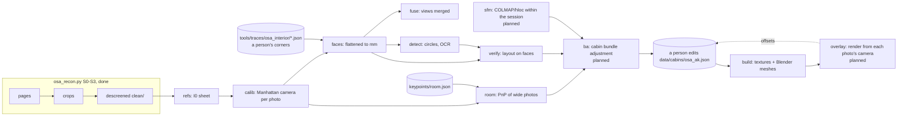

# The Osa's interior from photographs: the measurement pipeline (plan, first stages built)

The interior comes first (`docs/OSA_MODEL_ROADMAP.md`, steps I0-I8). This document covers the pipeline that turns the
book's cabin photographs and drawings (`docs/research/OSA_BOOK_WWP_2026-11.md` §4) into measured faces, positions and
checks for `data/cabins/osa_ak.json`. It also covers the tools, algorithms, plugins, MCPs and skills chosen for the
greatest accuracy those photographs allow. It is the interior's counterpart of `docs/OSA_EXTERIOR_RECONSTRUCTION.md`
and shares that pipeline's framework (`tools/recon/osa_recon.py`): resume, input hashes, retries, isolation per photo,
and optional stages that skip with their reason.

**The holistic layer** (8 Nov 2026, `docs/OSA_INTERIOR_HOLISTIC.md`) sits in front of this pipeline: every photo
observed at face value and every component in it classified and identified, one register of the compartment's
components (`data/cabins/osa_ak_components.json`) fused from Fig. 3, the cabin data, the text and those observations,
and schematics drawn from it. It tells this pipeline *what* is there and roughly *where*; this pipeline then measures it.
Its trace queue (`docs/research/OSA_INTERIOR_COMPONENTS_2026-11.md`) is the order in which faces come here.
Its second half, the **look-alike check** (9 Nov 2026, H6-H9, that spec's §11-14), sits after this pipeline. It renders
the built cabin from each photo's camera and lists what the model lacks, down to the small details. It reads this
pipeline's solved cameras and traced faces but changes none of its stages; the zones it finds unexplained come back here
through the trace queue.

Built: `tools/recon/interior.py` (the algorithms), `tools/recon/osa_interior.py` and `osa_interior.json` (the
orchestrator), and `tools/tests/test_interior.py` (synthetic cabins with a known camera). Planned: the stages marked
*planned* below.

## 1. What the inputs are, and what that decides

| Fact | Consequence |
|---|---|
| 76 interior photos (book pp. 82-101), all of **one** ex-NVA 9A33BM3-1, taken in one session, plus 9 drawings | Unlike the exterior (many vehicles, decades apart), the photos share one rigid scene. Overlapping views can be **solved together** (a bundle adjustment of the cabin), not only one at a time. Decision D1: the AK keeps its own blocks; shapes are taken where the AK shares the block. |
| Printed halftone (period about 3 px at the scan), flash, cropped prints | Measure on the descreened `clean/` crops, never on super-resolved ones. The principal point is not at the crop's centre, so it is estimated or left free. Glare and hard flash shadows hide edges, so a person marks the corners. |
| The cabin is a box: walls, racks and block faces lie on three orthogonal directions | A **Manhattan** model: every photo's camera (focal length, principal point, rotation, lens bend) comes from its own straight edges, without any known point. |
| Many faces are photographed square-on (racks, the cabinet, the dash) | These photos carry no camera information (the vanishing points are at infinity). Their **frontal** flattening relies on the quad itself and one known size. |
| Sizes known from sources: Fig. 3's plan (`mon_2112_80`), SŁ-2M 1.89 m, the R-123M's sourced front, rack standard widths | **The scale chain**, plan → rack → block → control, with an uncertainty carried down every link (§5). |
| The current cabin layout is a sourced first estimate (`data/cabins/osa_ak.json`) | It is the prior: the photos **correct** it, and every correction is reported as an offset in mm, never applied silently. |

What the photos cannot give: anything hidden (the backs of blocks, the inside of the cabinet), anything that no photo
shows square-on to better than about ±3 mm, and colours truer than one flashlit print allows. These limits are stated
in §8.

## 2. Architecture



| Stage | Built | Does | Writes | Roadmap |
|---|---|---|---|---|
| `refs` | yes | catalogue pp. 82-101 → every panel's photos and drawings by alias (`panel_aliases`) | `refs.json`, `reports/interior_refs.md` | I0 |
| `calib` | yes | per photo: line segments (LSD), plumb-line k1, three vanishing points by RANSAC, focal length and principal point, rotation | `calib.json` | I1-I5 |
| `faces` | yes, optional | each traced face flattened to millimetres by one of three methods (§3.3) | `faces/*.png`, `faces.json` | I2-I5 |
| `fuse` | yes, optional | several views of one face aligned (ECC, coarse to fine) and merged by median | `fused/*.png` | I2-I5 |
| `detect` | yes, optional | round parts (Hough in mm), plate text (Tesseract rus+eng) as **candidates** | `candidates.json` | I2-I5 |
| `room` | yes, optional | each wide photo's camera by PnP on named panel corners; the layout's error at each corner | `room.json` | I1 |
| `verify` | yes, optional | the layout's controls drawn on each flattened face; offset to the nearest detected part | `verify/*.jpg`, `reports/verify.json` | I2-I5 |
| `build` | yes, off | `cabin_textures.py --only panels` and `build_cabin_interior.py` once a person has moved the traces into the data | the cabin's textures and meshes | I8 |
| `sfm` | planned | features matched within the session (§3.6) | sparse points, cameras | I1 |
| `ba` | planned | the cabin's plane-constrained bundle adjustment (§3.7) | corrected panel poses with σ | I1-I5 |
| `drawings` | planned | the book's line drawings (ПУ-303, Fig. 3) registered to faces | control positions from drawings | I5 |
| `overlay` | planned | the built cabin rendered from every solved camera and its edges compared with the photo's | chamfer distance per photo, a contact sheet | proof, §1 of the roadmap |
| `materials` | planned | colours measured against the white labels as a neutral | a material table with sources | I6 |

## 3. The algorithms, stage by stage

### 3.1 Line segments and lens bend (`calib`)

- **Segments:** OpenCV's LSD (`cv2.createLineSegmentDetector`) on the descreened crop. DeepLSD (MIT) is an upgrade for
  flash-lit, low-contrast faces once the plain detector's misses are measured. Segments under about 20 px are dropped.
- **Lens bend:** a one-term radial model, with k1 normalised by the half-diagonal, fitted by the plumb-line method
  (`plumb_k1`). It minimises the straightness residual of edge chains that should be straight. The fit is accepted only
  when it straightens them by at least 30 % and stays inside ±0.15. Otherwise k1 = 0: most crops are from the
  middle of a normal lens, and a term fitted to curved parts such as cables is wrong. The first run gave
  k1 = 0 on 66 of 67 photos, which is expected for these prints.

### 3.2 Camera from the box (`calib`)

- **Vanishing points:** RANSAC over segment pairs, with a consistency score in angle (`vanishing_points`, threshold
  1.5°), each point refined by least squares. Up to three points, each one orthogonal to those already found.
- **Intrinsics** (`intrinsics_from_vps`):
  - With three well-placed points, the principal point is the triangle's orthocentre and f² = −(vᵢ−p)·(vⱼ−p).
  - With two, the principal point is assumed at the centre or at a prior.
  - A point more than four frame sizes from the centre is ill-conditioned (the face is nearly square-on), so it is
    not used.
  - The best-placed pair wins, not the one giving the largest f.
  - f must lie between 0.4 and 8 frame widths, and a principal point found from three points must lie in the middle
    80 % of the frame.
  - Before these gates the first run gave f/w from 0.24 to 34.7. After them, 26 photos are calibrated, with f/w from
    0.41 to 2.41. That range is plausible for crops of 35 mm film shot at 24-85 mm.
- **Rotation:** the three cabin axes in camera coordinates, from K⁻¹·v, then orthonormalised (`rotation_from_vps`).
- **Uncalibrated photos** (41 of 67) are mostly square-on views. They go to the frontal method (§3.3), or are given a
  camera by `room` or `ba` once enough points in them are named.

### 3.3 Flattening a face (`faces`)

Each face's trace (§6) gives its four corners.

**The corners are measured first** (`refine_quad`, on by default; `"refine": false` in a trace keeps its corners):
- The raw crop's halftone is removed by **notches** at its spectral peaks (`descreen_notch`, cached in `notched/`).
  That keeps the edges as sharp as the scan, where `clean/`'s Gaussian softens them.
- Every 2 raw px along each side, a smooth step is fitted across the edge. A robust (Tukey) line goes through the
  steps.
- The corners are where the four lines meet. No corner is looked at, so a corner under a cable, in a chamfer or
  off the print comes out as well as a visible one.
- A trace's `edge_spans` say where each side is the face's edge (blocks that aren't flush, rows that run off the
  print).
- Each corner gets a σ from a bootstrap of its sides' edge points.
- **Synthetic test** (a perspective face through a 3 px halftone at 45°, noise, one corner under a blob, guesses
  ±3 px off): every corner within 0.33 px. On the notched image σ is about 0.1 px, honest to within a factor of 3.
  On a Gaussian-blurred image σ comes out 3-5 times too small (the blur's bias), so measure on the notched one.

Then the method is chosen per face, best first:

1. **camera:** the photo is calibrated and the face lies on the cabin's axes (cosine ≥ 0.98). The metric rectifier
   H = S·R_p·K⁻¹ maps the face's plane to a fronto-parallel view. The **aspect comes from the camera**; only the scale
   comes from the known width. The photo is undistorted first when k1 ≠ 0. Its accuracy is limited by the vanishing
   points: about 0.5-1 % of the face's size on these crops, which is ±2-5 mm on a 0.5 m block.
2. **frontal:** the photo is uncalibrated, but the face is a rectangle seen nearly square-on or turned a little
   (`quad_aspect`).
   - The quad's own sides give the plane's vanishing line.
   - For each plausible camera (focal length 0.5-4 frame widths, principal point up to 15 % of the frame off
     centre, because the prints are cropped) at which the sides meet at a right angle within about 1°, the corners
     back-projected onto that plane give an aspect.
   - The aspect is taken at the centred camera's best right angle. Its **spread** over all accepted cameras, combined
     with 1.5 px of tracing error, is its uncertainty.
   - Faces with a spread over 5 % are refused (`max_aspect_spread`).
   - The tests prove 1 % on a 7° turn seen at 1.6 m on a cropped print (spread 4 %), and refusal of a 40° turn whose
     aspect would be 12 % off.
   - This suits most rack photos (g093-b, g091-a, g097-a).
3. **layout:** neither of the above. The quad is mapped onto the layout's size. This **trusts the layout**, so the face
   gives positions on the face but no check of its outline, and `faces.json` flags it.

`faces.json` records the method, the size in mm and the layout's size. The stage reports the median height offset
against the layout for the faces flattened by camera or frontal: the first number to say whether the layout is right.

### 3.4 Several views of one face (`fuse`)

- Views of one panel are aligned to the sharpest one (Laplacian variance) by ECC with a homography, coarse to fine
  (0.25 → 0.5 → 1.0). A view whose correlation stays under 0.6 is left out.
- The aligned views are merged by **median**, which drops flash glare and halftone residue: in the test, the fused
  image's error is under 0.75 of a single view's.
- Only views flattened by camera or frontal are merged. A layout-mapped view would carry the layout's error into the
  fusion.

### 3.5 Candidates on a face (`detect`) and the check (`verify`)

- **Round parts:** Hough circles in millimetre units (radius 3-45 mm) on the flattened face: knobs, lamps, dials,
  meters.
- **Plates:**
  - Tesseract 5 with `rus` and `eng`. It has only `eng` and `osd` today: add `rus.traineddata` (tessdata_best) to
    `C:/Program Files/Tesseract-OCR/tessdata`.
  - PaddleOCR (its Cyrillic model) or EasyOCR (`ru`) as a second reader. A plate counts as **read** only when two
    readers or two photos agree.
  - Never fill an unread letter by guesswork; mark it `?` and leave it for a person.
- **Masks (optional):** SAM 2 (Apache-2.0), prompted by the layout's control positions, cuts each part's outline. It
  helps where Hough misses rectangular parts (toggles, sockets, plates). OWLv2 or Grounding DINO can propose boxes
  ("toggle switch", "dial") when no layout prior exists. Both give candidates only; a person accepts each part.
- **verify** draws every layout item on its flattened face and reports each one's offset to the nearest candidate,
  with the panel's median. A median offset under 2 mm on a camera or frontal face means the panel is done (roadmap §1).

### 3.6 Solving within the session (`sfm`, planned)

The interior photos overlap: the main console from several sides (g094-a/b/c, g095-a/b), the cab from both doors, the
rear from the door. Because they show one vehicle in one session, structure from motion is valid among them, unlike
across the whole book.

- **Features:** SuperPoint and LightGlue via hloc. SuperPoint's weights are for non-commercial use: run it locally as a
  measuring tool and never ship it. DISK + LightGlue (Apache-2.0) is the permissive alternative. Classical SIFT fails
  on halftone, which gives repeated dots and few true corners: descreen first, and match at half resolution.
- **Solver:** COLMAP (BSD) through pycolmap, with the cameras' focal lengths seeded from `calib` and the principal
  point free per photo (cropped prints).
- **Expectation:** partial models of three to eight photos each, not one model of the cabin. Each partial model is
  scaled by a known size and becomes a set of constraints for `ba`, not a model of its own.
- **Not used:** RealityScan (formerly RealityCapture) and Meshroom. They need dense, evenly lit overlap, which these
  prints do not have. Keep them for a museum visit (§9).

### 3.7 The cabin's bundle adjustment (`ba`, planned): the accuracy step

One least-squares problem (`scipy.optimize.least_squares` with a sparse Jacobian; Ceres is not needed at this size).

- **Unknowns:**
  - each panel's pose: centre (3 numbers), facing and tilt (2), and size (2), around the layout;
  - each solved photo's camera: R, t, f, principal point and k1.
- **Observations:**
  - the corners that people traced (`faces` and `keypoints`);
  - vanishing directions from `calib`, as rotation priors;
  - the scaled points of `sfm`.
- **Priors, each with its σ:**
  - Fig. 3's plan dimensions (±10 mm);
  - known block sizes;
  - "on the wall": a rack's back lies on its wall plane;
  - coplanarity of the blocks in one rack;
  - the layout itself, weakly (±50 mm), so that unobserved panels stay put.
- **Output:**
  - corrected panel poses, each with its standard deviation from the covariance (J^T J)^-1;
  - the residual per photo;
  - a list of which panels moved by more than their σ, and why.

  A person reviews this list and edits `data/cabins/osa_ak.json`. The solver never writes the data.
- **Robustness:** a Huber loss, plus a check that every panel is observed in at least two photos or through one prior
  before its size is freed.

### 3.8 Drawings (`drawings`, planned)

- The book's labelled ПУ-303 drawing and the compartment's Fig. 3 are line art. Register each to its flattened face by
  four or more corresponding corners (a homography), then take the labels' positions as control positions.
- Where a drawing and a photo disagree, the photo wins for position and the drawing for identity. Record both.

### 3.9 Overlay proof (`overlay`, planned)

- Render the built cabin in Blender from each solved camera, at the photo's size. The Blender MCP can do this from a
  session, or `blender --background` can run a script beside `tools/blender/build_cabin_interior.py`.
- Then take Canny edges of the render and of the photo, and compute the chamfer distance with a distance transform.
  Convert it to mm on the face plane, and lay the two over each other on a contact sheet.
- This is method §4 of `docs/MODELLING_FROM_PHOTOS.md` applied to a whole room: the roadmap's proof for I1-I5.

## 4. Tools, plugins, MCPs and skills, chosen for accuracy

| Kind | Choice | Role | Why it raises accuracy, or why it is kept out |
|---|---|---|---|
| Library | OpenCV 4 (LSD, ECC, Hough, PnP, warp) | the measuring core | Exact, and testable on synthetic cabins |
| Library | NumPy, SciPy `least_squares` | vanishing points, rectifiers, the bundle adjustment | A sparse least-squares solver with robust losses and covariance, and no build step |
| Detector | DeepLSD (MIT) | segments on flash-lit faces | More complete lines where LSD breaks; adopt only if `calib` shows LSD's misses |
| SfM | COLMAP / pycolmap, hloc + LightGlue (DISK or SuperPoint) | `sfm` inside the session | Joint cameras for overlapping photos; SuperPoint is non-commercial and used locally only |
| Manual camera | fSpy, with its Blender importer | a person's check of one photo's camera | An independent second solve from hand-placed vanishing lines; a tie-breaker when `calib` and `room` differ |
| OCR | Tesseract 5 rus+eng (tessdata_best), PaddleOCR (Cyrillic), EasyOCR (`ru`) | plates | Two readers must agree; nothing invented |
| Segmentation | SAM 2; OWLv2 or Grounding DINO | part outlines and boxes | Candidates for a person, prompted by the layout |
| Monocular depth | Depth Anything V2 (Small, Apache-2.0; the larger weights are non-commercial), Metric3D v2 | depth of protruding parts (knob heights, handle reach) | Weak evidence only, weighted far below geometry; never a position |
| Super-resolution | Real-ESRGAN | viewing only | **Never measured on**: it invents edges |
| Vectorising | Potrace | legible plates and decals as clean outlines for textures | Clean art without the halftone |
| Existing tools | `photo_trace.py`, `cabin_textures.py`, `build_cabin_interior.py`, `panel_sheet.py`, `ue_cabin_shots.py`, `crew_pose_dump` | rectify one photo; textures; meshes; panels laid flat; Unreal shots; crew bodies against racks | Already proven on the R-123M and the PU-12M |
| MCP | **Blender** (`mcp__Blender__*`) | inspect and render the cabin, place a camera from `room` or `ba`, screenshot the overlay | Closes the loop between photo and model inside one session |
| MCP | **unreal-mcp** | the cabin in the editor: lighting, CRTs, seat and rack clearances | I8; the editor must be open |
| MCP | in-app browser | sources on the web (Commons, archives) | References only, cited in `docs/SOURCES.md` |
| Skill | `model-from-photos` | the method: flatten, trace in 3-D, overlap tests, photo-camera overlay | **Always followed** for each block |
| Skill | `hard-surface`, `blender-modeler` | blocks, latches, handles, bevels | Accurate chamfers at block scale |
| Skill | `materials`, `texture-workflow`, `uv-workflow` | I6 colours, decals, texel density | Materials measured, not invented |
| Skill | `asset-optimization`, `lod-pipeline`, `unreal-export`, `qa-review` | I8 | Budget and export checks before Unreal |
| Skill | `blender-director` | to plan a multi-step Blender session | Coordination only |

**Tracing, re-surveyed (8 Nov 2026, after the first trace).** On cropped halftone scans the edge detector is not the
limit. Three things are: the unknown principal point, the halftone screen, and hidden or rounded corners. In order of
gain:

1. **Measure edges along their whole length.**
   - Descreen with an FFT notch filter: find the screen's lattice peaks and remove them with their harmonics. Unlike
     a Gaussian, it keeps edges sharp.
   - Take sub-pixel edge points (Devernay; IPOL 2017).
   - Fit an erf step to the intensity profile across the edge at every point along it, then fit the line with a
     robust (Tukey) least squares.
   - Corners are the lines' intersections. This works where a corner is hidden or rounded, and beats
     `cv2.cornerSubPix`. Expect 0.1-0.3 px, against today's 1-2 px.
   - **Built (8 Nov 2026):** `descreen_notch`, `fit_edge` and `refine_quad`, used by the faces stage (§3.3).
     Pure NumPy/OpenCV, with a smooth tanh step rather than erf: the position is unbiased for any symmetric blur.
     Devernay edge points were not needed.
2. **The cabin's bundle adjustment with a free principal point per print** (§3.7). This is the only fix for the
   cropped-print intrinsics, which no single-image method can fix. Start it from COLMAP and hloc with **ALIKED or
   DISK + LightGlue** (Apache-2.0); SuperPoint's weights are non-commercial.
3. **Ellipses, not Hough circles, for knobs and lamps.**
   - Fit Devernay points with `cv2.fitEllipseDirect`; detect with AAMED.
   - Correct the centre for perspective: an ellipse's centre is not the circle's centre, and on an oblique face
     the difference is several mm.
4. **Part outlines by SAM 2.1 point prompts** (Apache-2.0), in **X-AnyLabeling** (GPL; `pip install
   x-anylabeling-cvhub`), or in napari with Python refinement on each click. The masks follow the halftone to
   1-2 px, so they propose and step 1/3 measures.
5. **PaddleOCR 3 with PP-OCRv5's East Slavic model** (`pip install paddleocr`, `lang="ru"`) for stamped plates, on
   the rectified, descreened plate upscaled 2-3×. Cross-check with Tesseract `tessdata_best` rus and with Claude
   reading the crop; a person confirms each plate.

Further notes:
- **Priors only:** GeoCalib (Apache code, CC-BY weights) gives one image's focal length and distortion, but it fixes
  the principal point at the centre. Use it as a prior, never a value.
- **Licence flags for the owner:**
  - MASt3R, DUSt3R and the original VGGT weights are non-commercial. Research use only, for starting values.
  - **SAM 3** (text prompts, Nov 2025) and **VGGT-1B-Commercial** both exclude military uses in their licences.
    Don't adopt either without the owner's decision.
- **Not worth it:**
  - learned line detectors (DeepLSD, ScaleLSD, HAWPv3) to replace LSD: more lines, not more precise ones, and
    heavy builds on Windows;
  - learned descreening: stale models trained on digital halftones;
  - OpenCV MCP servers: nothing over running Python;
  - PhotoModeler: it duplicates item 2.
- **Unverified:** fSpy's and Perspective Plotter's Blender add-ons are not confirmed on Blender 5.x. For Blender work
  the Blender MCP and the `model-from-photos` skill remain the tools.

Rejected:
- **AI image-to-3-D generators**: they invent geometry and are unsourced.
- **Photogrammetry over the whole book**: many vehicles, decades apart.
- **Measuring on the 3-D reference mesh in `reference/`**: its licence is unknown, so it is a visual reference only.
- **Upscaled images in any measurement.**

### Installed (8 Nov 2026)

`tools/recon/setup_tools.ps1` installs everything into `E:\SAM3D-tools` (C: has about 8 GB free), in its own venvs,
so the system Python the simcore tools use is untouched. `tools/recon/smoke_tools.py` runs each tool once on a book
photo and its flattened face:

```bash
E:\SAM3D-tools\venv\Scripts\python.exe tools/recon/smoke_tools.py out/recon/<book run>/photos/clean/g093-b.png out/recon/interior_dryrun/faces/sp2m_g093b.png
```

| Tool | Where | Smoke test on g093-b / SP-2M2 |
|---|---|---|
| PyTorch 2.11 + CUDA 12.8 | `venv` | RTX 3060 Ti seen |
| SAM 2.1 (base+, Apache-2.0) | `venv`, weights in `models\` | one click on the row-2 left meter gives its outline, about 86 × 59 mm, score 0.98, in 4 s |
| PaddleOCR 3 / PP-OCRv5 (`lang="ru"`) | `venv` | runs. It needs `enable_mkldnn=False` on this CPU, because Paddle 3's oneDNN path fails with PP-OCRv5 |
| Tesseract 5 + `tessdata_best` rus, eng | `tessdata\`; set `TESSDATA_PREFIX` | runs. The system install still has only eng and osd, so the detect stage passes `--tessdata-dir` (the config's `tools.tessdata`). That folder needs Tesseract's `configs` and `tessconfigs` beside the models, or it writes .txt instead of .tsv |
| LightGlue + ALIKED/DISK (Apache-2.0), hloc 1.5 | `venv`, sources in `src\` | hloc lists `aliked+lightglue` and `disk+lightglue`. On g093-b against a known warp of itself: 1890 matches, 1874 inliers, mean error 0.25 px. Weights in the torch hub cache; GitHub's downloads failed (504) for an hour on 8 Nov |
| pycolmap 4.2.1 (CPU) and COLMAP 4.2.1 with CUDA | `venv`; `colmap\bin\colmap.exe` | run |
| GeoCalib (Apache-2.0, CC-BY weights) | `venv` | g093-b: f ≈ 0.75 frame widths. A prior only: it fixes the principal point at the centre |
| X-AnyLabeling 4.3 (GPL) | its own `venv-label` (its pins clash) | runs: `E:\SAM3D-tools\venv-label\Scripts\xanylabeling.exe` |
| Brush (Apache-2.0) | `brush\brush_app.exe` | present; checksum checked by the script |
| MoGe-2 (MIT), trimesh + Embree, pycolmap, scipy | their own `venv-depth`, using `venv`'s torch through a `.pth` | depth and normals for the holistic layer's comparison (`docs/OSA_INTERIOR_HOLISTIC.md` sections 31-33); 1M rays in 0.24 s |

Quirks:
- **E: records no file ownership** (exFAT), so git refuses to work in clones there, and pip can't install `git+`
  URLs onto it. The script clones each package into `src\` and installs it from the folder. It does not add a
  global `safe.directory` exception.
- **hloc** names LightGlue by a git URL, so it goes in with `--no-deps` and its other requirements are named.
- **SAM 2's** optional CUDA extension needs nvcc, so `SAM2_BUILD_CUDA=0`; SAM 2 runs without it.
- **PowerShell 5.1** turns pip's and git's progress lines on stderr into errors under `ErrorActionPreference
  Stop`, so the script checks exit codes instead.

Not installed:
- **DeepLSD, ScaleLSD and AAMED:** no gain for the effort (see above), or a C++ build.
- **SAM 3 and VGGT-Commercial:** military exclusions in their licences.
- **MASt3R, DUSt3R and the original VGGT:** non-commercial.
- **Postshot:** paid.
- **RealityScan:** through the Epic Games Launcher, when a museum visit is planned.
- **KIRI 3DGS Render (Blender) and SplatRenderer (UE):** no splat to view yet, and the KIRI add-on's licence is
  unchecked.

### Gaussian splats (surveyed 8 Nov 2026)

**Verdict:** a photoreal 3-D *picture* to walk through and lay our model against, not a measuring tool, and never
shipped content.

- **Accuracy.** On DTU's table-top objects with known cameras, the surface methods reach 0.5-0.8 mm Chamfer (2DGS
  0.80, PGSR about 0.5, plain 3DGS 1.96). In a 6 m room with good alignment and scale bars, expect about
  0.5-2 cm. That is no better than COLMAP's or RealityScan's dense mesh, since all of them depend on the same camera
  alignment.
- **Licences.** Most mesh-from-splat methods (2DGS, SuGaR, MILo, GOF, Inria's 3DGS) are non-commercial. Few-view
  splatting (InstantSplat, Splatt3R) rests on MASt3R/DUSt3R's CC BY-NC-SA weights.
- **From the book.** A few halftone scans per wall, flash-lit and with no parallax, give a convincing view only near
  the original camera angles and smeared geometry everywhere else. At most an afternoon's experiment. MapAnything
  (Apache-2.0 weights, metric feed-forward reconstruction) is the cleanly licensed one to try.
- **As game content: no.** A splat carries the light it was captured in (no CRT glow, lamps, or day and night),
  has no collision, cannot be operated as controls, and sorts and overdraws heavily in a cluttered cabin. No major
  game ships splat environments.
- **Tools, all with open licences:**
  - **Brush** (Apache-2.0, a Windows build on Vulkan, no CUDA needed) trains and views. It is installed.
  - **SuperSplat** (MIT, in the browser) crops and aligns.
  - Blender: the **KIRI 3DGS Render** add-on supports Blender 5.1-5.2; its licence is to be checked before use.
  - Unreal: **SplatRenderer** (Apache-2.0, UE 5.5-5.7).
  - **gsplat**/nerfstudio (Apache-2.0) if Brush isn't enough.
  - Postshot's free tier can't export splats.
  - LichtFeld (GPL) and OpenSplat (AGPL) add copyleft and no accuracy.
- **Where they pay off: a museum visit.** The capture protocol:
  - 200-300 stills on a fixed focal length, with exposure and white balance locked and no flash;
  - diffuse LED light;
  - 70-80 % overlap in three height bands per wall, plus convergent shots into the corners;
  - two or three scale bars and coded targets in every zone, and tape and calliper checks of key sizes.

  RealityScan (Epic, free under $1M revenue) then aligns the photos and builds the **metric mesh** we measure on.
  Its COLMAP export trains a Brush splat as the visual reference beside it, in Blender or UE.

## 5. The scale chain and its uncertainty

| Link | Source | σ |
|---|---|---|
| Compartment: length, width, height | Fig. 3 (`mon_2112_80`), the hull data (`tools/recon/osa_9a33bm2.json`) | ±10 mm |
| Rack positions on the walls | `room` / `ba` on the wide photos, against the compartment | ±10-15 mm |
| Rack sizes | the rack's square-on photo (frontal or camera) scaled by its height in Fig. 3, or SŁ-2M's 1.89 m | ±3-5 mm |
| Block outlines in a rack | the rack's flattened face; blocks of one standard width check each other | ±2-3 mm |
| Controls on a block | the block's flattened face, scaled from the block's outline | ±1-2 mm on the block; the block's σ added |

Each value moved into `data/cabins/osa_ak.json` carries its photo ids, its method and its σ in the entry's source
note. A value is used only when its σ is below the roadmap's target for that level (§1 of the roadmap).

## 6. Tracing a face (a person's step)

Each face is one file in `tools/traces/osa_interior/<face>.json`. The first one is
`tools/traces/osa_interior/sp2m_g093b.json`:

```json
{
  "photo": "g093-b",
  "panel": "sp2m_panel",
  "what": "which edges make the face",
  "corners_px": [[73.3, 101.5], [1848.9, 168.8], [1886.2, 1265.3], [46.0, 1360.1]],
  "corners_how": "how each corner was found",
  "known": { "width_mm": 1890.0 },
  "known_source": "where the size comes from, and whether it is a measurement or an assumption",
  "force_layout": false
}
```

**How the corners were found on g093-b** (the way to do it when a corner is hidden or off the print):
- fit each edge as a line to the white-block/dark-recess step found at 9-37 places along it (residuals 0.3-1.2 px);
- take each corner where two lines meet.

Two of its corners are not on the print as points. The bottom-left lies in the wall's chamfer. The bottom-right lies
a few pixels past the print's edge: the right column leans outward going down, and its rows 3-4 run off the print.

- **Corners:**
  - Mark them on the descreened `clean/<photo>.png`, in order tl, tr, br, bl as seen facing the panel.
  - Use the face's outer edge, not its frame's.
  - Zoom to the halftone: aim at the edge's middle, never at its glare.
- **`known`:** `width_mm` or `height_mm`, with its source. Without it, the layout's width is used and the face checks
  only the aspect.
- **Wide photos** get named panel corners in `keypoints/room.json` instead:
  `{"g094-a": {"so_panel.tl": [x, y], "fo_panel.br": [x, y], ...}}`, at least six points over two or more walls.

Rules for the person tracing:
- trace what is seen, not what is expected;
- a corner hidden by a cable or a door is left out;
- for a quick check, run the pipeline and open `verify/<face>.jpg`.

Claude can propose corners from the LSD segments and the layout's projection. A person accepts or moves them; this is
the only manual step before `ba`.

## 7. Human checkpoints

1. **After `refs`:** the reference sheet. Are the photos assigned to the right panels, and is the BM3-only hardware
   marked?
2. **After `faces`:** each flattened face beside its photo. Is it square, and is the method sensible?
3. **After `detect`:** candidates accepted or rejected, and plates read by two readers or marked unread.
4. **After `ba`:** the list of moved panels, each with its σ and its evidence, then the edit to the data.
5. **After `overlay`:** the contact sheet. Any photo over 10 mm (compartment) or 3 mm (block) goes back to step 2 or 4.

## 8. Failure modes and honest limits

| Failure | Seen as | What the pipeline does |
|---|---|---|
| Flash glare and hard shadows | missing edges, false circles | median fusion; corners placed by a person; glare masked (V > 0.95) before Hough |
| Halftone residue | dot-pattern edges and SIFT matches | descreen before everything; match at half resolution; ECC on blurred pyramids |
| Wide-angle bend at a crop's edge | k1 at the bound | k1 refused unless it clearly straightens the lines; corners near the edge weighted less in `ba` |
| A near-square-on photo | f unbounded | uncalibrated; the frontal method or `room` instead |
| A crop's principal point | the orthocentre outside the middle 80 % | the two-point estimate with the centre assumed; freed only in `ba` |
| BM3-1 hardware absent on the AK (ПКР toggle, BM3 blocks) | a block with no AK counterpart | `refs` flags it; D1 keeps the AK's blocks; the BM3 cabin is I9 |
| A Czech 2000s repaint and additions | colours, plates | excluded from I6; the photo's caption decides |
| Two readers disagree on a plate | OCR mismatch | marked unread; never guessed |

**What the book cannot give**, and what would close the gap:
- the backs and sides of blocks that no photo shows: they keep the sourced layout's estimate, marked so;
- ±1 mm on controls in a face that is only seen obliquely;
- true colour under flash.

A visit to a preserved vehicle (Lešany, Dresden, Koblenz, Polish museums) with a tape and a phone (60+ evenly lit
overlapping shots for RealityScan or COLMAP) would turn each of these from estimates into measurements. So would the
NVA's own drawings (`barch_a327_153`, `/154`).

## 9. Running it

```bash
python -E -P -X utf8 tools/recon/osa_recon.py run tools/recon/osa_9a33bm2.json       # S0-S3 first: crops and descreened photos
python -E -P -X utf8 tools/recon/osa_interior.py run tools/recon/osa_interior.json
python -E -P -X utf8 tools/recon/osa_interior.py status tools/recon/osa_interior.json
python -E -P -X utf8 -m pytest tools/tests -q -k "recon or interior"
```

Re-running is cheap: a stage reruns only when its inputs' hash changed (`--force <stage>` overrides). Optional stages
skip with their reason, as do the stages after them ("needs faces (skipped)").

First run (8 Nov 2026, from the book's 446 crops):
- `refs`: 76 photos and 9 drawings, 16 of 17 panels with references;
- `calib`: 26 of 67 photos calibrated (2 by three vanishing points).

The first face, SP-2M2 from g093-b, ran end to end:
- **faces:** method frontal; the block grid's aspect is **1.55 ± 0.06**, where the layout has 1.92 (1.89 × 0.982 m).
  The layout gave SP-2M SŁ-2M's length and height ("the same"), an assumption.
- **Which dimension is wrong: the height.** SŁ-2M's 1.89 × 0.982 m comes from SAM Simulator's three column pictures
  (`samsim_panels`, 610/670/610 × 982 px at 1 mm per pixel). Those pictures are **crops of the columns**: the range
  column's top meter row is cut off, and every column stops short of its bottom blocks. So 0.982 m is the art's
  height, not the rack's. The widths hold, because the art takes in whole blocks. At 1.89 m, SP-2M's three columns
  come out 0.62-0.64 m each, the same block standard. So **SP-2M2 is about 1.89 × 1.22 m (±0.05 m)**.
- **SŁ-2M itself is taller than 0.982 m too.** Its search column in g094-a is about 0.47 as wide as it is tall, seen
  obliquely; at 0.67 m wide that is roughly 1.3 m.
- **Fig. 3 agrees only roughly.** Its A-A and B-B sections draw both racks about 1.8 times as wide as tall
  (1.03-1.07 m at 4.785 mm per pixel). It is a schematic table of block names, slightly squashed in height, and
  isn't used for heights.
- With the racks reaching the roof (lining at z 2.10), SP-2M's bottom moves from z 1.11 to about 0.88: 0.26 m
  above the floor, which matches the kick strip in g092-a. Applied with the model below (centre z 1.47, 1.89 ×
  1.24 m).
- **The corners, measured along the sides** (`refine_quad`, 8 Nov):
  - edge points per side: top 580, left 333, bottom 342, right 43;
  - σ: top-left 0.15 px, top-right 0.82 px, bottom-left 0.32 px, bottom-right 2.7 px. The bottom-right corner is
    extended far from the right side's only in-print stretch (row 2, 150 px);
  - the sides scatter 0.5-1.6 px about their lines: the blocks' own small steps, not noise;
  - the corners moved 1.5-10.8 px from the first trace's coarse fit;
  - the aspect is unchanged: **1.5508** (was 1.5505), height 1218.8 mm at 1.89 m.
- **detect:** 43-45 round parts. Knobs, both meters and the 23-socket block are found; most yellow lamps are lost to
  flash glare.
- **OCR** (Tesseract with tessdata_best rus): it reads nothing on the whole face, at best single characters at
  94 %. Across a whole rack the photo has about 1.5 raw px per mm, so the plates' letters are 5-7 px tall in a
  halftone. Plates are read from close-ups (g092-d/e), one plate at a time, by PaddleOCR, Tesseract and Claude, and
  a person confirms each.
- **verify:** the layout's 202 items are an even fill ("drawn only"), so only 7 fall within 25 mm of a part. The rack
  is I3's first job: its blocks and their parts, traced from this face.

**SP-2M2 measured, traced and modelled end to end** (8 Nov 2026, docs/MODELLING_FROM_PHOTOS.md with this pipeline's
tools; the trace's docstring holds the method, `tools/blender/sp2m_trace.py`):

| Step | What came out |
|---|---|
| Flatten | g093-b notched, its outer edges, then a correcting homography (shear -0.25 %, aspect 1.0063): five bezels round to 0.5 %, row tops evenly spaced. The pitch grows 240.5 → 246.7 mm down the face: ±3 mm in y, unresolved |
| Blocks | 18 blocks, each side found on its boundary profile (plate → lip → light rail → shadow band) and fitted along its length: rms 0.2-0.4 mm, profile-only sides about 1 mm |
| Parts | 507 read in 3 px/mm tiles, 311 round ones re-centred on their blobs (median shift 0.6 mm); screws 6.2 mm, lamps 10.8, jacks 20.1, locks 27, bezels 62.6/39 |
| Heights | g092-a against the flat front: ALIKED + LightGlue 3697 matches, the plane by MAGSAC (1044 inliers, 2.0 px), g092-a's camera from it (f 3497 px, rms 3.3 px); parallax heights ±3 mm. Tables 16-19 mm, a pointer knob 19, meter scales 4, socket field 6, locks 4-10, bezel rims to 7 |
| Overlap tests | `tools/tests/test_sp2m_trace.py` (8): they caught a jack's chain read as a key, four blobs that took in a neighbour, R3's lock off the print |
| Model | `tools/blender/sp2m_model.py` → SM_SP2M2Face (84 k triangles, 1.893 × 0.042 × 1.242 m), `build_sp2m.py` exports it and renders the checks |
| Checks | `photo_trace.py overlay`: the front ortho on the flattened g093-b and the render from g092-a's solved camera on g092-a (undistorted) both land on the blocks, the tables, handles, socket field and meters; the meters' housings stood further out than their scales, so they took a 15 mm rim |
| Cabin | `sp2m_panel` bare, 1.89 × 1.24 m, top unchanged; its 18 blocks at their measured rects (Unreal skips a bare panel's blocks); the rack fill and the guessed latches gone; nameplates on the measured plates; the Qc scale in the OR-31M's middle bezel |

**Measured:** every block edge and every part's place and size on the face (to about 0.3-1 mm, ±3 mm in y from the pitch);
the heights of tables, knobs, meters, sockets, locks, bezels, strips and rails (±3 mm). **Scaled:** everything by one
factor, the face's 1890 mm width taken from SŁ-2M (SAM Simulator's column pictures at 1 mm a pixel, the layout's and
Fig. 3's scale), good to about ±2 %; no part of known size was legible to check it. **SAM3D's choice:** the other
heights, the parts' shapes in depth, the colours of parts the photos show only as a shade, the frame recess's 8 mm, and
which bezel is the Qc scale. Left: the plates' text (close-ups g092-d/e), the rack's frame and door detail from g092-a.

## 10. Mapping to the roadmap

| Roadmap step | Stages | Manual work |
|---|---|---|
| H0-H5 | `tools/recon/holistic.py` (`seed`, `check`, `fuse`, `draw`, `report`), observers per photo | read the observations' doubts; settle conflicts |
| H6-H9 | `tools/recon/holistic_view.py` (`pose`, `render`, `compare`, `cast`, `report`); reads `faces`' and `room`/`ba`'s cameras, writes nothing here | list each photo's details; judge the sheets |
| I0 | `refs` | review the sheet |
| I1 | `calib`, `room`, `sfm`, `ba`, `overlay` | name corners in the wide photos |
| I2, I3, I4, I5 | `faces`, `fuse`, `detect`, `verify`, `drawings`, `ba` | trace each face; accept candidates; read plates |
| I6 | `materials` | pick the neutrals |
| I7 | the register's runs, fittings and kit (`holistic.py report`), placed by `ba` once their photos are solved | each item cited |
| I8 | `build`, `overlay`, then `ue_cabin_shots.py`, `helper_coverage` | review in Unreal |
| I10 | none: the detail kit (`tools/blender/detail_kit.py`) builds from H9's cast details and the traced faces' measured parts | size each part |

Model use: Opus 5.5 or Fable 5.1 for `ba` and diagnosing calibration; Opus 5.5 for reading the plates and judging
traces; Sonnet 5.5 for moving finished traces into the data.
