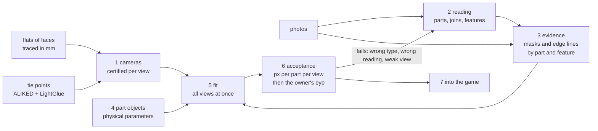

# Modelling the Osa from photographs: the process

*Status: **design approved 10 Nov 2026; on trial in part C** (`docs/research/OSA_REBUILD_C_2026-11.md`: the tools are
built; the right post, the two housings and the first-aid box are rebuilt and pass; the right racks and the 0096-9M2
were moved to where the photographs have them; the bench and seats are still to do). It becomes the standing rule, with its skill and the line in
`CLAUDE.md`, when the project owner accepts part C. It answers `docs/research/OSA_ACCURACY_AUDIT_2026-11.md`, which
measured where the last process lost accuracy. Sections 8-10 (what it changes, what it costs, what is not proven) are
the checkpoint's own and are trimmed then.*

Once accepted, this is how every part of the Osa is modelled or edited, inside and out. It builds on
`docs/MODELLING_FROM_PHOTOS.md`, which stays the method for a single piece of equipment with a flat front.

## 1. The idea

A photograph is reliable in two dimensions. So the evidence stays there: every part's outline and edges, measured in
each photo by code and carrying the part's name. The 3-D model is then made to answer to that evidence in every photo at
once, through cameras that have been proven against things of known shape. A part is done when its outline lands on
the photo's within a few pixels in each view, and the owner's eye agrees.

Five rules, each from a measured failure:

| Rule | Why (audit) |
|---|---|
| **1. A camera is proven before it is used.** Each view carries a certificate; an uncertified view may be looked at, never measured or judged through | The cameras everything was measured through put SP-2M2 39-97 px off; one faced the opposite wall |
| **2. Reading comes first and stays attached.** What a part is, how it is made and how it joins its neighbours is written down before any number, and every later measurement carries that part's id and the name of the edge it is | The cover's outline was read from the wrong edges, 100-250 px off in its own photo; the first pass had the object right and was not consulted |
| **3. Numbers come from code on the full-resolution photo.** Claude picks from numbered masks and numbered edges; it never reads a coordinate off a picture | Boxes drawn by eye are 1-5 % of the frame out; images are shown downscaled |
| **4. Shape is fitted to outlines in all views together; depth only suggests.** | Parts lifted by depth are 2-7 cm out and 1.5-2 times too big; the depth map is 5.5 cm out at part edges even with a perfect camera |
| **5. Acceptance is per part, per view, in pixels of outline, then by eye.** No area score decides anything | An exactly right model scores 64 %; deleting the post's leg and cover moves the score 0.02 % |

## 2. Who does what

| | Does | Never |
|---|---|---|
| **Claude's vision** | Names parts; says what each is, how it is made, how it joins; picks numbered masks and edge chains; judges overlays at 1:1 | Reads coordinates; declares a part fixed from a downscaled picture |
| **Code** | Every number: cameras, outlines, fits, errors | Decides what a thing is |
| **The owner** | Judges overlays by eye at checkpoints; settles conflicts between sources | |

Pictures for reading and judging are tiles at 1:1 or larger, small enough (about 1000 px) that they are shown undiminished.

## 3. The stages

### Stage 1. Cameras

**Control.** A *control face* is a flat face with a millimetre flat made without any camera (the faces stage of
`docs/OSA_INTERIOR_PIPELINE.md`, kept unchanged). Two kinds:

- **The frame's face**: SP-2M2. Its points are fixed in the cabin. Everything else is placed against it.
- **Rigid plates**: every other flat (the 0096-9M2's door now; SŁ-2M, SP-3M's panel, SŁ-3M and the aft door to add).
  Their shape is known; their place, turn and one scale are solved *with* the cameras. A face whose place in the cabin
  came from an earlier solve is never fixed control: the probe showed the door's stored place fighting SP-2M2 by
  20-40 px.

**The solve.** The joint solve's tracks (ALIKED + LightGlue, as before) and the flats matched into every view go into
one bundle adjustment (COLMAP's, through pycolmap): cameras, focal lengths, lens terms and tie points move, the frame's
face stays, the plates move as rigid bodies. The principal point is free within a bound (the prints are cropped), with
a pull to the centre. `holistic_refine.py` and its cameras are retired.

**The certificate**, per view, written beside the camera:

| Grade | Has | May |
|---|---|---|
| **A** | A control face in view, its matches within 3 px (median), tie points within 1.5 px | Measure and judge |
| **B** | No control face, but tie points shared with A views within 1.5 px | Show, and add evidence at low weight (σ 20 px). No part is accepted on B views alone |
| **C** | Not solved, or square-on to one plane (g093-b) | Supply flats only |

Each view is also solved once with its own control left out. What its control then misses by is recorded: it is the
honest figure for how far such a view can be trusted away from its control.

**What the probe showed** (`tools/recon/audit/probe_cameras.py`):

| | Before (the solve as it was) | After |
|---|---|---|
| SP-2M2 in its four views | 3.9-22.6 px | 0.9-1.4 px with the principal point free; 1.7-2.3 px with it held (and g093-a's 40 matches 21 px) |
| The door in its five views, as a plate solved with the cameras | 118-250 px against its stored place | 1.3-1.8 px (1.4-3.0 held) |
| Tie points | 0.94 px | 0.66 px (0.80 held) |
| A view solved without its own control | | **1.9, 9.1, 22.4 and 32.2 px** (3.9 to 51 held): this is why grade B may not judge |
| The door, against where the cabin has it | | **0.11 m further left, 4-9 cm further forward, 3-6 % larger** (the ranges are the principal point free and held) |

### Stage 2. Reading

Zone by zone, each photo at 1:1, before any measurement. For every part (`tools/traces/osa_interior/parts/<id>.json`):

- **What it is and how it is made**: a pressed channel, a box, a plate with a rolled edge, a casting. This chooses its
  part type in stage 4.
- **How it joins**: stands on, bolted to, passes in front of, hangs from. Joins become constraints in the fit and
  parent frames in the data.
- **Its features, by name**: the faces and edges that show (a housing has `face`, `band`, `rim`, `outer`; a channel
  `web`, `flange_aisle`, `flange_wall`, its creases).
- **Where it shows**: which photos, which of its features in each, what hides it.
- **Whether it is the same thing in each photo.** An id is shared between photos only with a reason; stage 5 then
  tests it (two different objects under one id cannot both fit).

The first pass's observation files are the start. They were mostly right.

### Stage 3. Evidence

For each photo, two numbered pictures made by code (`sam_tools.py auto`, `edge_tools.py`; both proven on g098-a):

- **Masks**: SAM 2.1's automatic masks, numbered. Good to a few pixels wherever a part differs in tone from what is
  round it (scores 0.93-0.98 on the flap, the boxes, the lamps, the cabinet).
- **Edge chains**: every edge as a numbered chain, each point placed to a fraction of a pixel on the gradient's peak.
  This is what pressed sheet metal against the same paint needs: the housing's rim came out as a handful of chains end
  to end, the post's creases as long single chains, where SAM 2 scored 0.6-0.8 and leaked.

Claude answers with numbers only: *part `housing.right`, feature `rim`, photo g098-a, chains 118, 130, 74, 0, 3,
59*. A point prompt is the fallback where neither picture has the thing; a prompt says which thing, it is never a
measurement. Each accepted item is drawn back on the photo at 1:1 and looked at before it is kept.

Three things part C taught:
- **A pick can be the neighbour's edge.** A chain taken for the housing's foot was the strap plate's. Drawn back it
  was plain, and in the fit it showed as the worst tenth of one view. Look at both.
- **Which of several parallel edges is the same edge in each photo** need not be judged by eye: try the
  combinations, and the right one is the one whose outlines fit one plane.
- **Picked chains are kept as separate pieces**, never joined end to end: a join draws a line the photo does not have.

Stored in `tools/traces/osa_interior/evidence/<photo>.json`: the picks, and the measured polylines (coordinates, like
today's traces; no photograph is committed). Masks are regenerated, not stored.

### Stage 4. Part objects

A part is one object, defined in one place, with its own frame and parameters that mean something:

| Type | Parameters | First use |
|---|---|---|
| `Plate` | outline (from evidence, as many points as it needs), thickness, edge roll | brackets, the latch's plates |
| `RoundedBox` | three sizes, corner radius | first-aid box, chest |
| `Extrusion` | a profile carried along a straight or curved spine | housings, the bench |
| `PressedChannel` | spine (a curve in space), web width, flange depths, bend radii | the posts |
| `Loft` | sections at stations | whatever the others cannot hold |
| `TracedFace` | today's millimetre traces | racks, the cabinet |

- Pure Python (no `bpy`), in `tools/recon/osa/parts.py`: each type gives its mesh and its named feature curves, so
  the fit, the tests and Blender read the same object.
- A part has a **parent**: the latch's plate lives in the housing's frame. Moving the housing moves what is on it.
- Parameters are stored in `data/cabins/osa_ak_parts.json`, each with `source` and `confidence` as now. Outlines come
  from evidence by code, never typed.
- `build_cabin_interior.py` gains one call that builds every part object; its procedural code stays for what has not
  been moved over.

### Stage 5. Fit

One least-squares problem per part (or per small group that touch):

- **Unknowns**: the part's place, turn and parameters.
- **Evidence**, in every A view (B views at low weight):
  - each named edge: the distance between the model's feature curve, projected, and the evidence polyline of the same
    name, both ways;
  - the silhouette against the mask, where there is one.
- **Weak terms**: triangulated points that fall inside the part's masks in two or more views (so a point is labelled
  by the masks, not by judgement); the depth map, for a first guess only.
- **Constraints from the reading**: sits on that floor, flush to that plane, sheet of that thickness.
- **Cameras stay fixed.** A part is never allowed to move a camera: registering on the whole model once let a wrong
  cabinet turn a camera 15 degrees. Cameras change only in stage 1, when control is added.
- **Several starts**, and the covariance for each parameter's ±.

What part C added to the fit:
- **A flat outline seen in two or more photos fixes its own plane**: the plane on which the photos' outlines, cast
  back through their cameras, lie on one another (`fit.plane_of_curves`). The outline then comes from the evidence,
  point by point, not from typed numbers.
- **Square unless the photos insist.** A face is held square to the vehicle when turning it free closes the fit no
  better. Two neighbouring faces that both close better at the same turn are the photos insisting (the housings: 12
  degrees). Faces of one wall are fitted as one plane (`groups`).
- **Tie points are labelled by outlines** (`cameras.points_in`): the joint solve's points that a photo sees inside a
  part's outline, placed again by the certified cameras. Four of them settled which plane a face seen whole in only
  one photo lies in.
- **A wrong identification does not fit**, and is kept: the evidence file's `not_this` says what was taken for the
  part, and what it turned out to be.

If a part cannot reach the gate with its parameters free, the pattern of what is left says why: the type cannot hold
the shape (take the next type down the table), the reading is wrong (two objects under one id, an edge given the wrong
name), or a view is weaker than its grade.

**What the probe showed** (`probe_fit.py`): the first-aid box as a `RoundedBox`, fitted to its masks in g098-a and
g096-a at once.

| | g098-a | g096-a |
|---|---|---|
| As the model has it | 37.5 px (a tenth beyond 159) | 34.5 px (a tenth beyond 112) |
| Fitted | **1.3 px** (a tenth beyond 5.5) | **1.1 px** (a tenth beyond 5.6) |

It came out 0.34 × 0.25 × 0.07 m, where the model has 0.39 × 0.29 × 0.28. Its thickness rests on little: both
photos see it nearly face on.

### Stage 6. Acceptance

A part is accepted when, in every A view that sees it:

| Measure | Gate |
|---|---|
| Photo's outline to the model's, median | the larger of 4 px and 0.25 % of the photo's width (about 3-5 mm at the part) |
| The same, the worst tenth | three times that |
| Views | two A views at least 15 degrees apart. A part seen in one view is accepted as *one view*: its distance along the ray comes from what it touches, and its confidence says so |
| The overlay | photo, photo with the model's outline, model render, at 1:1: Claude first, then the owner at a checkpoint |

The accepted figures are stored with the part. `tools/tests/test_osa_parts.py` recomputes them from the stored
cameras and evidence (no photographs, no GPU) and fails when a part's error grows past 1.2 times what was accepted, or
when a camera's control drifts past its certificate.

### Stage 7. Into the game

As now: export, `cabin_mesh_sync.py`, the checks of handoff section 9, the owner's re-import in Unreal.

## 4. The order of work

1. **Control and cameras** for the zone, until every view that will judge is grade A. Adding a control face (a flat
   and its matches) is the cure for a B view.
2. **The room**: floor levels, walls, roof, bulkhead, as parts fitted to their junction lines.
3. **The bodies that stand in it**: rack carcasses, housings, posts, the bench.
4. **What is mounted on them**, in their frames: plates, latches, lamps, boxes.
5. **Detail**: fasteners, seams, labels, by the detail inventories as before.

**Editing a part later** is the same loop, entered at the stage the complaint points to: a wrong shape at 4, a wrong
place at 5, a part that is not what it was taken for at 2.

## 5. What is kept

- Flattening a face and tracing it in millimetres: now also the source of control.
- Rays cut with a plane: for first guesses, through grade A cameras.
- Triangulated points as anchors, once labelled by masks.
- Depth maps and `holistic_diff.py`'s sheets: for finding where to look. Its score and its findings decide nothing.
- The side-by-side render through the photo's camera.
- `source` and `confidence` on every value; overlap tests; `tools/recon/interior.py` unchanged.

## 6. Considered

| Proposal | Decision | Reason |
|---|---|---|
| Per-part masks and edge polylines as the primary evidence, tied to the register's ids | **Adopted**, masks where a part contrasts, edge chains for pressings | Both proven on g098-a; ties the name to the geometry |
| Parts as objects with physical parameters, each defined in one place | **Adopted**, with parent frames and `Loft` as the fallback | Ends the stitched readings and the retyping; a traced part already lands within 12 px |
| Fitting each part to its outlines in all views at once, depth and points as softer terms | **Adopted** | 37 px to 1.2 px on the probe |
| Refining the cameras together with the parts | **Rejected** | A wrong part pulls the camera. Cameras move only when control is added |
| Acceptance per part and view in pixels, with an overlay | **Adopted** | The only measure that saw what the owner sees |
| Deciding which cameras may judge which parts | **Adopted** as the certificate | A view without control missed by 2-32 px in the probe |
| A differentiable renderer (nvdiffrast, PyTorch3D) | Rejected for now | Parts have ten parameters, not ten thousand; numpy and SciPy fit in seconds with no new dependency |
| Monocular depth as a measurement | Rejected | 5.5 cm at part edges at best |
| SAM 3, VGGT-Commercial | Not used | Their licences exclude military use (owner's decision) |
| Image-to-3-D generators, splats as geometry | Rejected, as before | They invent shape and cannot be sourced |

## 7. Tools

| Tool | State |
|---|---|
| `tools/recon/audit/camera_audit.py`, `part_audit.py`, `ident_audit.py`, `synth_audit.py` | Built: the audit |
| `tools/recon/audit/probe_cameras.py`, `edge_tools.py`, `sam_tools.py`, `probe_fit.py` | Built as probes; they become the process's tools |
| `tools/recon/osa/cameras.py`: flats to control (also from a rectangle in a photo), the adjustment with rigid plates, certificates | Built (the plates are solved by turns with the adjustment, which settles in two rounds) |
| `tools/recon/osa/evidence.py`: numbered masks and chains, picks, stored outlines | Built |
| `tools/recon/osa/parts.py`, `fit.py`, `store.py`, `accept.py`, `render.py`, `recipes/` | Built for `Extrusion`, `Tube`, `RoundedBox`; `PressedChannel` and `Loft` when a part needs them |
| `tools/tests/test_osa_parts.py` | Built: cameras hold their control, parts stay within what they were accepted at |
| `.claude/skills/osa-model/SKILL.md`, the rule in `CLAUDE.md` | Part D, after the owner accepts part C |

All of it runs under `E:/SAM3D-tools/venv-depth`, which already holds SAM 2.1, LightGlue, pycolmap and SciPy.

## 8. What it changes

**Retired:** `holistic_refine.py`'s cameras and `holistic_diff.registered_camera` as a camera to measure through; the
depth score as a gate; findings as instructions; the withheld-pin gate; outlines typed by hand; coordinates read by eye.

**Suspect until measured again through grade A cameras** (everything read by rays or depth since section 32):

- the 0096-9M2's place and size (the probe: 0.11 m further left, 3-6 % larger; its working controls ride on it);
- the housing beside it, the plinths and the raised floors (sections 33-37);
- the hung machine, the GA-3's bracket, the blower's cover (section 36);
- both posts, the "cover", the latch (sections 27, 31, 40, 41);
- the seats' height on the bench, reasoned partly from g093-b (section 38);
- the left racks' 0.37 m move and the aisle's width (section 28): open again, and settled by a control face on the left wall.

**Not changed:** the faces traced in millimetres and their parts; the cab's group (not yet in scope); simcore; the game.

## 9. What it costs

| | Cost |
|---|---|
| Building the tools of section 7 | The larger part of two working sessions. The probes already do the hard half of each |
| Four more control faces (SŁ-2M, SP-3M's panel, SŁ-3M, the aft door) | A flat each: corners by edge fit, an aspect check on round parts, matches. No part tracing is needed for control. About an hour each, less with practice |
| A simple part (a box, a plate) | Minutes: picks, a fit of seconds, an overlay |
| A hard part (a post, a housing) | An hour or more the first time: the reading, a part type that may need a second try, two or three views |
| Running it | The adjustment 30 s; masks 1-2 min a photo; chains seconds; a fit seconds to a minute; the tests seconds, without photos |
| Measuring again | The parts of section 8, in the order of section 4 |
| The owner | A look at overlays at each checkpoint; three decisions (section 11) |

## 10. Not proven yet, and what happens if it fails

| Risk | What part C will show | If it fails |
|---|---|---|
| A pressed channel that bends in two planes may not fit `PressedChannel` | The right post, three views | `Loft`: sections at stations, each fitted to the chains |
| Views with no control | Whether four more faces make every judging view grade A | Such views only show; the parts seen only in them stay low confidence |
| The principal point | Free, some cameras ran to 59 % off centre in the probe, and the door's size came out 3 % or 6 % larger by the choice | A bound and a pull to the centre; the spread is stated as the uncertainty until a second wall has control |
| Edge chains on halftone at low contrast break into pieces | The post's lower leg, the floor's pressed edges | Chains joined by pick; a seeded edge fit along a prompt line |
| A part seen in one view | The latch's bracket | Its depth from what it is bolted to |
| The scale | SP-2M2's 1.89 m is assumed (±2 %) and everything hangs on it | A part of known size read on any control face rescales the lot by one factor |
| The fit is given a wrong name for an edge | Residuals that will not close | The reading is corrected; this is the check stage 2 never had |

## 11. For the owner to decide

1. **Go ahead to part C** with this design: build the tools, then rebuild the right post with its housing, latch and
   bracket; the sloped housing beside the 0096-9M2 and the floor round it; the bench and the operators' seats.
2. **Control faces first** (recommended): add the four flats before the hard parts, so their views are grade A and the
   aisle's width is measured, not assumed.
3. **The 0096-9M2 moves**: accept that part C measures its place and size again, with its controls and the first
   lesson's references following.
